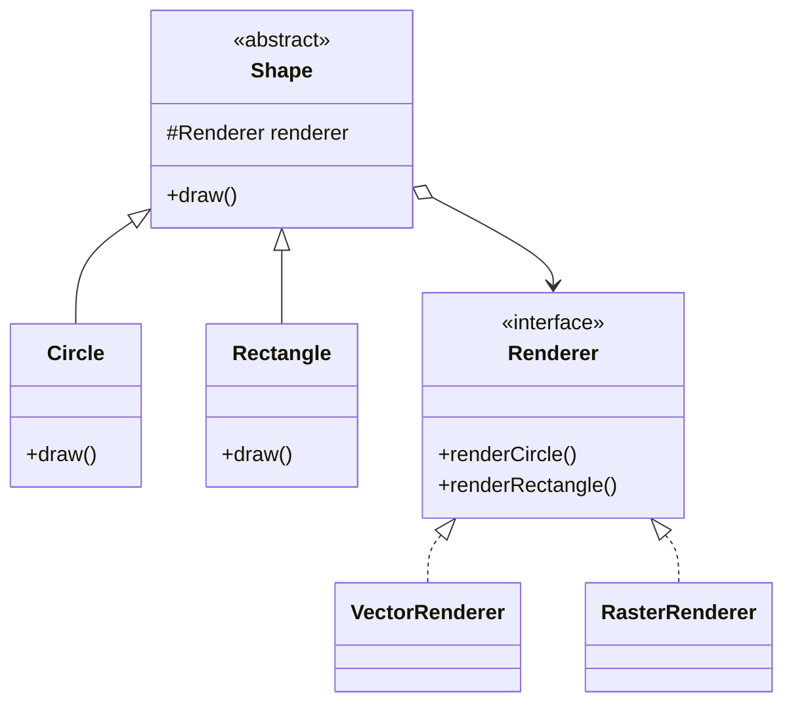
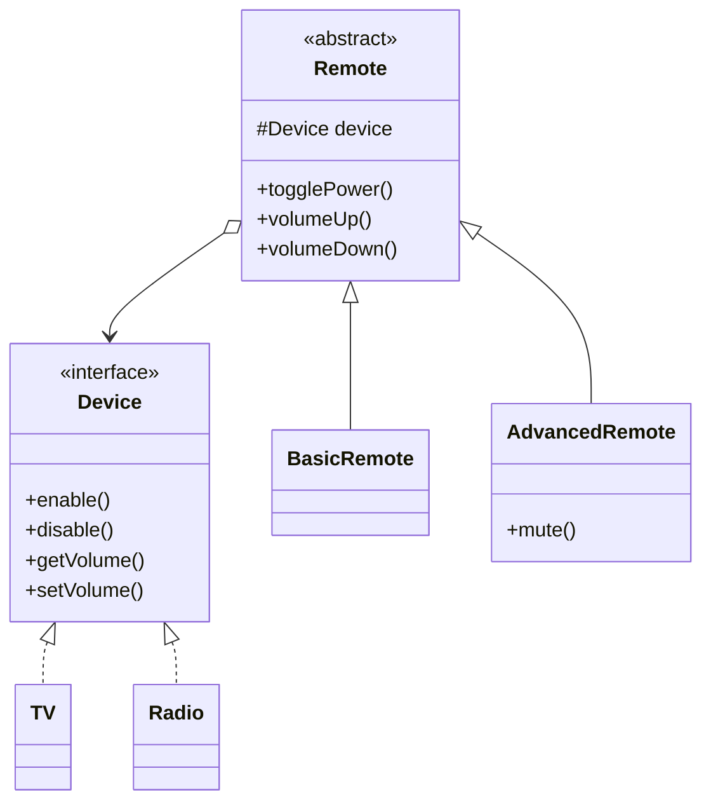

# Bridge Design Pattern

## 1. What is Bridge Design Pattern?

> 🔵 **Definition**
>
> Bridge is a Structural Design Pattern that separates abstraction from implementation so both can change independently.

**In simple words:**

It separates two different responsibilities into two class hierarchies and connects them using composition.

### Real-Life Example: TV Remote

Imagine you have:
- Different remotes (Basic Remote, Advanced Remote).
- Different devices (TV, Radio).

Both remotes should work with both devices.

Instead of creating separate classes for every combination, we keep them separate.

- Remote handles the controls.
- Device performs the actual operations.

```text
       Remote                 Device
          |                      |
    -------------           -----------
    |           |           |         |
   Basic     Advanced       TV       Radio
   Remote     Remote
```

**Important:** We can add a new remote without changing TV or Radio, and add a new device without changing existing remotes.

---

## 2. Why Do We Need Bridge Pattern?

Imagine a graphics application supporting:

**Shapes:**
- Circle
- Rectangle

**Rendering methods:**
- Vector
- Raster

### Without Bridge Pattern

We need separate classes for every combination.

```text
             Shape
               |
        ----------------
        |              |
      Circle        Rectangle
        |              |
      -------        -------
      |     |        |     |
    Vector Raster  Vector Raster
    Circle Circle Rectangle Rectangle
```

### Problems

🔴 **1. Class Explosion**

Every new combination requires another class.

🔴 **2. Tight Coupling**

Shape and rendering logic are mixed together.

🔴 **3. Difficult Maintenance**

Adding a new renderer requires creating new classes for existing shapes.

### Solution

Separate the two responsibilities:

- Shape decides what to draw.
- Renderer decides how to draw.

```text
       Shape              Renderer
         |                    |
    -----------          ------------
    |         |          |          |
  Circle  Rectangle    Vector     Raster
                       Renderer   Renderer
```

Now any shape can use any renderer.

---

## 3. Main Components

| Component | Meaning |
|---|---|
| Abstraction | Main class that defines the operations. |
| Refined Abstraction | Extends the abstraction. |
| Implementor | Interface for implementation. |
| Concrete Implementor | Provides actual implementation. |

### Class Diagram



**Remember:**

- Shape = Abstraction
- Circle and Rectangle = Refined Abstraction
- Renderer = Implementor
- VectorRenderer and RasterRenderer = Concrete Implementors

---

## 4. How Does It Work?

Suppose we want to draw a Circle using VectorRenderer.

**Step 1:** Create a renderer.

```java
Renderer renderer = new VectorRenderer();
```

**Step 2:** Pass it to Circle.

```java
Shape circle = new Circle(renderer, 5);
```

**Step 3:** Call draw().

```java
circle.draw();
```

**Step 4:** Circle delegates the work to Renderer.

```java
renderer.renderCircle(radius);
```

### Flow Diagram

```text
        Client
           |
           v
        Circle
           |
        draw()
           |
           v
  VectorRenderer
           |
           v
   Draws the Circle
```

🟢 **Key Point:**

- Circle knows what to draw.
- Renderer knows how to draw.
- Both work independently.

---

## 5. Java Implementation – Shapes and Renderers

### Step 1: Renderer Interface

```java
interface Renderer {

    void renderCircle(int radius);

    void renderRectangle(int width, int height);
}
```

### Step 2: Concrete Implementations

**VectorRenderer.java**

```java
class VectorRenderer implements Renderer {

    public void renderCircle(int radius) {
        System.out.println("Drawing Circle using Vector");
    }

    public void renderRectangle(int width, int height) {
        System.out.println("Drawing Rectangle using Vector");
    }
}
```

**RasterRenderer.java**

```java
class RasterRenderer implements Renderer {

    public void renderCircle(int radius) {
        System.out.println("Drawing Circle using Raster");
    }

    public void renderRectangle(int width, int height) {
        System.out.println("Drawing Rectangle using Raster");
    }
}
```

### Step 3: Abstraction Class

**Shape.java**

```java
abstract class Shape {

    protected Renderer renderer;

    public Shape(Renderer renderer) {
        this.renderer = renderer;
    }

    abstract void draw();
}
```

**Important line:**

```java
protected Renderer renderer;
```

Shape stores a Renderer reference instead of directly depending on VectorRenderer or RasterRenderer.

### Step 4: Refined Abstraction

**Circle.java**

```java
class Circle extends Shape {

    private int radius;

    public Circle(Renderer renderer, int radius) {
        super(renderer);
        this.radius = radius;
    }

    @Override
    public void draw() {
        renderer.renderCircle(radius);
    }
}
```

**Rectangle.java**

```java
class Rectangle extends Shape {

    private int width;
    private int height;

    public Rectangle(Renderer renderer, int width, int height) {
        super(renderer);
        this.width = width;
        this.height = height;
    }

    @Override
    public void draw() {
        renderer.renderRectangle(width, height);
    }
}
```

### Step 5: Main Class

```java
public class Main {

    public static void main(String[] args) {

        Renderer vector = new VectorRenderer();

        Renderer raster = new RasterRenderer();

        Shape circle = new Circle(vector, 5);

        Shape rectangle = new Rectangle(raster, 10, 20);

        circle.draw();

        rectangle.draw();
    }
}
```

### Output

```text
Drawing Circle using Vector
Drawing Rectangle using Raster
```

**Notice:** We can use different renderers with different shapes without creating extra combination classes.

---

## 6. Practical Example – Remote Control and Devices

Let's understand Bridge Pattern with a practical example.

We have:

**Remotes:**
- BasicRemote
- AdvancedRemote

**Devices:**
- TV
- Radio

Both remotes should work with both devices.

### Class Diagram



### Step 1: Device Interface

```java
interface Device {

    boolean isEnabled();

    void enable();

    void disable();

    int getVolume();

    void setVolume(int volume);
}
```

### Step 2: TV Class

```java
class TV implements Device {

    private boolean enabled = false;
    private int volume = 20;

    public boolean isEnabled() {
        return enabled;
    }

    public void enable() {
        enabled = true;
        System.out.println("TV ON");
    }

    public void disable() {
        enabled = false;
        System.out.println("TV OFF");
    }

    public int getVolume() {
        return volume;
    }

    public void setVolume(int volume) {
        this.volume = volume;
        System.out.println("TV Volume: " + volume);
    }
}
```

### Step 3: Radio Class

```java
class Radio implements Device {

    private boolean enabled = false;
    private int volume = 30;

    public boolean isEnabled() {
        return enabled;
    }

    public void enable() {
        enabled = true;
        System.out.println("Radio ON");
    }

    public void disable() {
        enabled = false;
        System.out.println("Radio OFF");
    }

    public int getVolume() {
        return volume;
    }

    public void setVolume(int volume) {
        this.volume = volume;
        System.out.println("Radio Volume: " + volume);
    }
}
```

### Step 4: Remote Abstraction

```java
abstract class Remote {

    protected Device device;

    public Remote(Device device) {
        this.device = device;
    }

    public void togglePower() {

        if (device.isEnabled()) {
            device.disable();
        } else {
            device.enable();
        }
    }

    public void volumeUp() {
        device.setVolume(device.getVolume() + 10);
    }

    public void volumeDown() {
        device.setVolume(device.getVolume() - 10);
    }
}
```

**Important:**

```java
protected Device device;
```

Remote contains a Device reference.

It does not need to know whether it is controlling a TV or Radio.

### Step 5: Basic and Advanced Remote

**BasicRemote.java**

```java
class BasicRemote extends Remote {

    public BasicRemote(Device device) {
        super(device);
    }
}
```

**AdvancedRemote.java**

```java
class AdvancedRemote extends Remote {

    public AdvancedRemote(Device device) {
        super(device);
    }

    public void mute() {
        device.setVolume(0);
    }
}
```

AdvancedRemote has an additional mute feature.

### Step 6: Main Class

```java
public class Main {

    public static void main(String[] args) {

        Device tv = new TV();

        Remote basicRemote = new BasicRemote(tv);

        basicRemote.togglePower();
        basicRemote.volumeUp();

        Remote advancedRemote = new AdvancedRemote(tv);

        advancedRemote.togglePower();

        Device radio = new Radio();

        AdvancedRemote radioRemote = new AdvancedRemote(radio);

        radioRemote.togglePower();
        radioRemote.mute();
    }
}
```

### Output

```text
TV ON
TV Volume: 30
TV OFF
Radio ON
Radio Volume: 0
```

### Understand the Practical Example

```text
       REMOTE                  DEVICE
          |                       |
     BasicRemote                  TV
          |                       |
   AdvancedRemote                Radio
```

- Remote handles the controls.
- Device performs the operations.
- Remote contains a Device reference.
- Both hierarchies can grow independently.

For example, we can add a new `VoiceRemote` without changing TV or Radio.

We can also add a new `Speaker` without changing the existing remotes.

---

## 7. Advantages

🟢 **1. Less Classes:** Avoids creating a class for every combination.

🟢 **2. Loose Coupling:** Abstraction depends on an interface.

🟢 **3. Easy Extension:** Both hierarchies can be extended independently.

🟢 **4. Reusability:** The same implementation can be used by different abstractions.

## 8. Disadvantages

🔴 **1. More Classes:** Requires separate abstraction and implementation classes.

🔴 **2. Initial Complexity:** Structure may be difficult to understand at first.

🔴 **3. Not Always Needed:** For simple applications, it can introduce unnecessary complexity.

---

## 9. Bridge vs Adapter

| Bridge | Adapter |
|---|---|
| Separates abstraction and implementation. | Connects incompatible interfaces. |
| Usually planned during system design. | Often used to integrate existing classes. |
| Allows both sides to change independently. | Makes existing components work together. |

**Example:**
- Bridge: Remote and Device.
- Adapter: Connecting an old charger to a new socket.

---

## 10. Important Interview Points

🟡 **Remember These Points:**

1. Bridge is a Structural Design Pattern.
2. It separates abstraction from implementation.
3. It uses composition instead of inheritance to connect both sides.
4. Both hierarchies can change independently.
5. It avoids class explosion.
6. Abstraction contains a reference to the Implementor.
7. It supports loose coupling and code reusability.

### One-Line Interview Definition

Bridge Pattern separates abstraction from implementation using composition, allowing both to change independently.

---

## 11. Quick Revision

| Question | Answer |
|---|---|
| Pattern Type | Structural |
| Main Purpose | Separate abstraction and implementation |
| Main Concept | Composition |
| Abstraction | High-level functionality |
| Implementor | Implementation interface |
| Concrete Implementor | Actual implementation |
| Main Problem Solved | Class Explosion |
| Example | Remote and Device |

---

## Final Remember Point

🟡 **Bridge = Two Independent Hierarchies + Composition**

Remember:

- Abstraction = What needs to be done?
- Implementation = How will it be done?
- Bridge = Connects both using composition.

**Example:** Remote decides which operation to perform, while TV or Radio performs the actual operation.