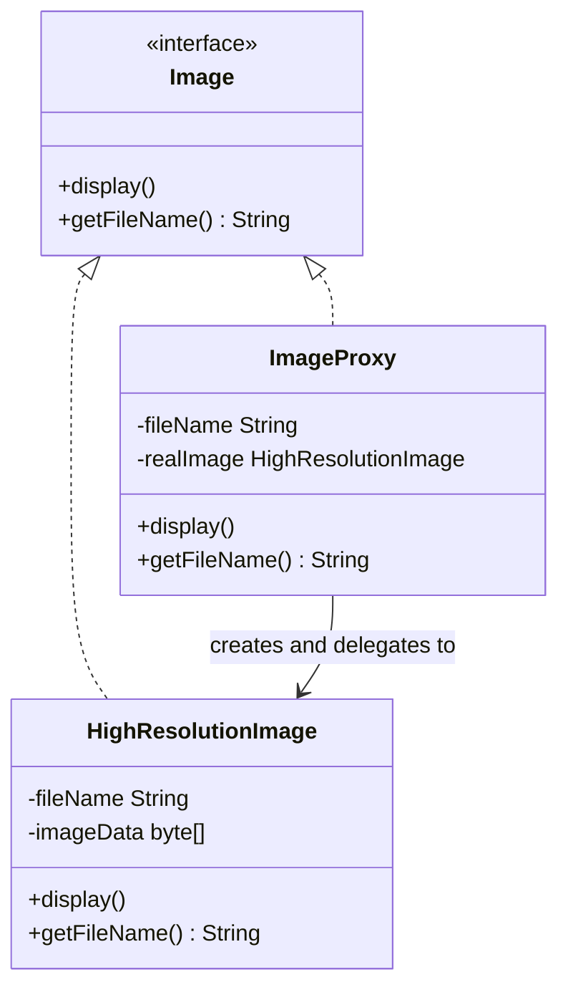
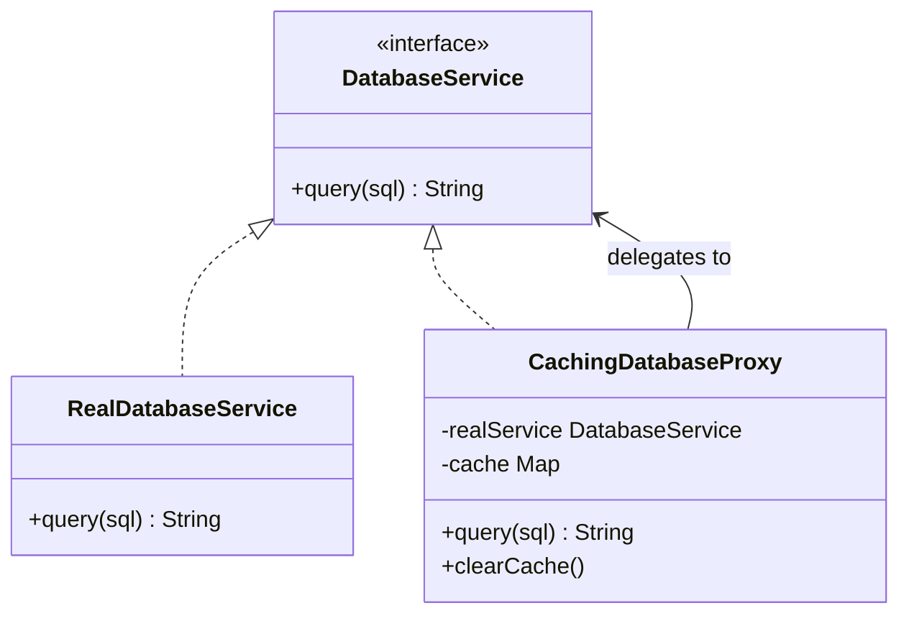

# Proxy Design Pattern

## 1. What is the Proxy Design Pattern?

> 🔵 **Definition**
>
> The **Proxy Design Pattern** is a structural design pattern that provides a substitute or placeholder for another object to control access to it.

In simple words:

A Proxy acts as a middleman between the client and the actual object.

Instead of accessing the original object directly, the client communicates with the Proxy. The Proxy decides whether to allow the request, delay it, or forward it to the actual object.

### Real-Life Example: Office Security Guard

Imagine you work in an office.

You cannot directly enter every restricted room. First, you need to pass through a security guard.

- You = Client
- Security Guard = Proxy
- Restricted Room = Real Object

The security guard checks your identity before allowing you to enter.

Similarly, a Proxy controls access to an actual object.

### How It Works

```text
       Client
          |
          | Request
          v
       Proxy
          |
     Check / Control
          |
          v
     Real Object
          |
          v
       Response
```

**Important:** The Proxy and the Real Object implement the same interface. This allows the client to use either of them in the same way.

---

## 2. Why Do We Need Proxy Pattern?

Imagine you are developing an Image Gallery application.

The application displays a list of images. Users can click an image to view it in full resolution.

Suppose each high-resolution image takes 10 MB of memory and 2 seconds to load.

You have three images:

- photo1.jpg
- photo2.png
- photo3.gif

### Problem Without Proxy

Suppose you create all three images when the application starts.

```java
HighResolutionImage img1 =
        new HighResolutionImage("photo1.jpg");

HighResolutionImage img2 =
        new HighResolutionImage("photo2.png");

HighResolutionImage img3 =
        new HighResolutionImage("photo3.gif");
```

Every image loads immediately during object creation.

```text
       Client
          |
    -----------------
    |       |       |
    v       v       v
  Image1  Image2  Image3
    |       |       |
  Load    Load    Load
  10MB    10MB    10MB

Total memory = 30 MB
Total loading time = 6 seconds (sequential)
```

But what if the user only opens photo1 and photo3?

The application has already loaded photo2 unnecessarily.

### Problems

🔴 **1. Slow Application Startup**

All images load even if the user never views them.

🔴 **2. Unnecessary Memory Usage**

Images that are never displayed still consume memory.

🔴 **3. No Control Over Access**

We cannot easily add permission checks or logging without changing the original class.

🔴 **4. Too Many Responsibilities**

The actual image class is responsible for both managing image data and deciding when to load it.

### What Do We Need?

We need a solution that:

1. Loads images only when users actually view them.
2. Saves memory and improves startup time.
3. Allows additional features like logging and permission checks.
4. Does not require modifying the original image class.
5. Keeps the client code simple.

**Solution: Proxy Design Pattern.**

---

## 3. How Does Proxy Pattern Work?

There are four main components.

| Component | Responsibility |
|---|---|
| Subject | Common interface for Proxy and Real Object. |
| RealSubject | Performs the actual work. |
| Proxy | Controls access to the Real Object. |
| Client | Uses the object through the common interface. |

### Class Diagram



### Understand Each Component

**1. Subject – Image**

- It is the common interface.
- Both Proxy and Real Object implement it.
- It declares the methods that the client can call.

Example:

```java
interface Image {
    void display();
    String getFileName();
}
```

**2. RealSubject – HighResolutionImage**

- It is the actual object.
- Performs the expensive operation.
- Loads the image data from the disk.

**3. Proxy – ImageProxy**

- Acts as a lightweight substitute.
- Stores the image filename.
- Creates the actual image only when required.
- Forwards requests to the real object.

**4. Client – ImageGalleryApp**

- Uses the Image interface.
- Does not need to know whether it is using a Proxy or the actual image.

> 🟡 **Important:** Proxy and RealSubject must implement the same interface so that the client can use them interchangeably.

---

## 4. Types of Proxy

Different proxies are used for different purposes.

| Type | Purpose | Simple Example |
|---|---|---|
| Virtual Proxy | Delays object creation | Load image only when clicked |
| Protection Proxy | Controls access | Only ADMIN can view confidential files |
| Remote Proxy | Represents an object on another system | Calling a remote server |
| Caching Proxy | Stores previous results | Avoid repeating database queries |
| Smart Proxy | Adds extra operations | Logging and monitoring |

Let's understand each one.

### 1. Virtual Proxy

> 🔵 **Definition:** A Virtual Proxy delays the creation of an expensive object until it is actually needed.

Example:

You open an image gallery containing 100 images.

Instead of loading all 100 images immediately, the application loads an image only when the user clicks it.

**Main purpose:** Lazy Loading.

### 2. Protection Proxy

> 🔵 **Definition:** A Protection Proxy checks whether a client has permission to access an object.

Example:

A company has confidential documents.

- ADMIN can access all documents.
- NORMAL users cannot access confidential documents.

The Proxy checks the user's role before forwarding the request.

**Main purpose:** Access Control and Authorization.

### 3. Remote Proxy

> 🔵 **Definition:** A Remote Proxy represents an object that exists on another machine or server.

Example:

Your application wants to communicate with a remote payment service.

Instead of handling network communication directly everywhere, a Remote Proxy provides a local interface and forwards requests to the remote service.

**Main purpose:** Handle communication with remote objects.

### 4. Caching Proxy

> 🔵 **Definition:** A Caching Proxy stores the results of expensive operations and returns stored results when the same request is made again.

Example:

You search for the same product multiple times.

Instead of querying the database every time, the Proxy can return the previously stored result.

**Main purpose:** Improve performance and reduce repeated operations.

### 5. Smart Proxy

> 🔵 **Definition:** A Smart Proxy adds additional behavior when accessing an object.

Example:

Whenever a user opens an image, the Proxy records:

- Who opened the image.
- When it was opened.
- How many times it was accessed.

**Main purpose:** Logging, monitoring and tracking.

---

## 5. Java Implementation – Virtual Proxy

Let's implement the Image Gallery example.

### Step 1: Create Subject Interface

**Image.java**

```java
interface Image {

    void display();

    String getFileName();
}
```

Explanation:

Both `HighResolutionImage` and `ImageProxy` will implement this interface.

### Step 2: Create RealSubject

**HighResolutionImage.java**

```java
class HighResolutionImage implements Image {

    private String fileName;
    private byte[] imageData;

    public HighResolutionImage(String fileName) {

        this.fileName = fileName;

        loadImageFromDisk();
    }

    private void loadImageFromDisk() {

        System.out.println("Loading image: " + fileName);

        // Simulate loading image data
        imageData = new byte[10 * 1024 * 1024];

        System.out.println("Image loaded successfully");
    }

    @Override
    public void display() {

        System.out.println("Displaying " + fileName);
    }

    @Override
    public String getFileName() {

        return fileName;
    }
}
```

Explanation:

- This is the actual image class.
- Its constructor calls `loadImageFromDisk()`.
- Loading happens immediately when an object is created.
- It contains the actual image data.

**Important:** We will not modify this class to implement lazy loading. The Proxy will handle that responsibility.

### Step 3: Create Proxy Class

**ImageProxy.java**

```java
class ImageProxy implements Image {

    private String fileName;

    private HighResolutionImage realImage;

    public ImageProxy(String fileName) {

        this.fileName = fileName;
    }

    @Override
    public void display() {

        if (realImage == null) {

            realImage =
                    new HighResolutionImage(fileName);
        }

        realImage.display();
    }

    @Override
    public String getFileName() {

        return fileName;
    }
}
```

### Understand This Code Carefully

**1. Why do we store the filename?**

```java
private String fileName;
```

Because we need to remember which image should be loaded later.

**2. Why do we store the real object?**

```java
private HighResolutionImage realImage;
```

This variable stores the actual image after it has been created.

Initially, its value is `null`.

**3. What does this condition do?**

```java
if (realImage == null) {

realImage =
        new HighResolutionImage(fileName);
}
```

This is the most important part.

- If the real image does not exist, create it.
- If it already exists, do not create another object.

**4. Why do we call this?**

```java
realImage.display();
```

Because the Proxy does not display the actual image itself.

It forwards the request to the RealSubject.

### Step 4: Client Class

**Main.java**

```java
public class Main {

    public static void main(String[] args) {

        Image img1 = new ImageProxy("photo1.jpg");

        Image img2 = new ImageProxy("photo2.png");

        Image img3 = new ImageProxy("photo3.gif");

        System.out.println("Gallery created");

        System.out.println(img1.getFileName());

        img1.display();

        img1.display();

        img3.display();
    }
}
```

### Output

```text
Gallery created

photo1.jpg

Loading image: photo1.jpg
Image loaded successfully
Displaying photo1.jpg

Displaying photo1.jpg

Loading image: photo3.gif
Image loaded successfully
Displaying photo3.gif
```

Notice:

- All three Proxy objects were created immediately.
- No actual image was loaded during gallery creation.
- `getFileName()` did not load the image.
- `photo1.jpg` was loaded only once.
- The second call to `display()` reused the existing object.
- `photo2.png` was never loaded.

---

## 6. Understand the Object Flow (Most Important)

### Step 1: Create Proxy

```java
Image img1 = new ImageProxy("photo1.jpg");
```

```text
Client
  |
  v
ImageProxy
  |
  | fileName = photo1.jpg
  |
  | realImage = null
  |
  v
No actual image created
```

No expensive operation happens here.

### Step 2: Call getFileName()

```java
img1.getFileName();
```

```text
Client
  |
  v
ImageProxy
  |
  v
Returns "photo1.jpg"
```

The Proxy already knows the filename, so it does not need the actual image.

### Step 3: Call display()

```java
img1.display();
```

```text
Client
  |
  v
ImageProxy
  |
  v
realImage == null?
  |
  | YES
  v
Create HighResolutionImage
  |
  v
Load image from disk
  |
  v
Call realImage.display()
```

Now the actual image is created.

### Step 4: Call display() Again

```java
img1.display();
```

```text
Client
  |
  v
ImageProxy
  |
  v
realImage == null?
  |
  | NO
  v
Reuse existing image
  |
  v
Call realImage.display()
```

No additional loading happens.

> 🟢 **Key Takeaway:** The Proxy delays object creation until the first expensive operation and reuses the same object for subsequent calls.

---

## 7. Protection Proxy – Access Control Example

Suppose only ADMIN users can view confidential images.

We can create another Proxy that checks permissions before allowing access.

**ProtectionImageProxy.java**

```java
class ProtectionImageProxy implements Image {

    private String fileName;
    private String userRole;

    private HighResolutionImage realImage;

    public ProtectionImageProxy(
        String fileName,
        String userRole
    ) {
        this.fileName = fileName;
        this.userRole = userRole;
    }

    @Override
    public void display() {

        if (fileName.contains("secret")
                && !userRole.equals("ADMIN")) {

            System.out.println("Access Denied");
            return;
        }

        if (realImage == null) {

            realImage =
                new HighResolutionImage(fileName);
        }

        realImage.display();
    }

    @Override
    public String getFileName() {

        return fileName;
    }
}
```

### Client

```java
public class Main {

    public static void main(String[] args) {

        Image img1 = new ProtectionImageProxy(
            "secret-image.jpg",
            "USER"
        );

        Image img2 = new ProtectionImageProxy(
            "secret-image.jpg",
            "ADMIN"
        );

        img1.display();

        img2.display();
    }
}
```

### Output

```text
Access Denied

Loading image: secret-image.jpg
Image loaded successfully
Displaying secret-image.jpg
```

Explanation:

- USER tries to access a confidential image.
- Proxy checks the role.
- Access is denied.
- ADMIN is allowed to access it.
- Only after permission is granted does the actual image load.

**Important:** The Image interface remains unchanged. We added access control inside the Proxy.

In a real Spring Security application, authorization should use trusted authentication information rather than a role string supplied directly by the client.

---

## 8. Logging Proxy – Tracking Method Calls

Suppose we want to record whenever someone displays an image.

Instead of modifying `HighResolutionImage`, we create a Logging Proxy.

**LoggingImageProxy.java**

```java
class LoggingImageProxy implements Image {

    private Image image;

    public LoggingImageProxy(Image image) {

        this.image = image;
    }

    @Override
    public void display() {

        System.out.println("Before displaying image");

        image.display();

        System.out.println("After displaying image");
    }

    @Override
    public String getFileName() {

        System.out.println("Getting image filename");

        return image.getFileName();
    }
}
```

### Client

```java
public class Main {

    public static void main(String[] args) {

        Image image =
            new ImageProxy("photo1.jpg");

        Image loggedImage =
            new LoggingImageProxy(image);

        loggedImage.display();
    }
}
```

### Output

```text
Before displaying image

Loading image: photo1.jpg
Image loaded successfully
Displaying photo1.jpg

After displaying image
```

### Understand the Wrapping

```text
        Client
           |
           v
   LoggingImageProxy
           |
           v
      ImageProxy
           |
           v
 HighResolutionImage
```

Here:

- LoggingImageProxy handles logging.
- ImageProxy handles lazy loading.
- HighResolutionImage handles the actual image.

Each Proxy has its own responsibility.

**Important:** A Proxy can wrap another Proxy because both implement the same interface.

---

## 9. Practical Example – Database Caching Proxy

Now let's understand another use case.

Suppose an application repeatedly executes the same database query.

For example:

```sql
SELECT * FROM employees WHERE id = 10;
```

Every time we execute this query, the application contacts the database.

This can waste time and resources.

### Solution: Caching Proxy

The Proxy stores the result of the first query.

When the same query is executed again, it returns the stored result instead of contacting the database.

### Class Diagram



### Step 1: Create Interface

```java
interface DatabaseService {

    String query(String sql);
}
```

### Step 2: Create Real Database Service

```java
class RealDatabaseService implements DatabaseService {

    @Override
    public String query(String sql) {

        System.out.println("Executing database query...");

        // Simulating a database response
        return "Employee: Deepanshi";
    }
}
```

### Step 3: Create Caching Proxy

```java
import java.util.HashMap;
import java.util.Map;

class CachingDatabaseProxy implements DatabaseService {

    private DatabaseService realService;

    private Map<String, String> cache = new HashMap<>();

    public CachingDatabaseProxy(DatabaseService realService) {

        this.realService = realService;
    }

    @Override
    public String query(String sql) {

        if (cache.containsKey(sql)) {

            System.out.println("Returning result from cache");

            return cache.get(sql);
        }

        String result = realService.query(sql);

        cache.put(sql, result);

        return result;
    }

    public void clearCache() {

        cache.clear();
    }
}
```

### Step 4: Client

```java
public class Main {

    public static void main(String[] args) {

        DatabaseService db =
            new CachingDatabaseProxy(
                new RealDatabaseService()
            );

        String sql =
            "SELECT * FROM employees WHERE id = 10";

        System.out.println(db.query(sql));

        System.out.println(db.query(sql));

    }
}
```

### Output

```text
Executing database query...
Employee: Deepanshi

Returning result from cache
Employee: Deepanshi
```

### Understand the Flow

```text
             Client
                |
                v
       CachingDatabaseProxy
                |
         Is result cached?
                |
          -------------
          |           |
         YES          NO
          |           |
          v           v
      Return       Real Database
      Cache             |
          |              v
          |         Execute Query
          |              |
          |              v
          |         Store Result
          |              |
          ------<---------
                |
                v
             Client
```

🟢 **Important:** The client uses the `DatabaseService` interface and does not need to know whether the result comes from the actual database or the cache.

*Note:* This is a simplified in-memory example. Real database caching also needs expiration, invalidation and consistency handling.

---

## 10. Advantages of Proxy Pattern

🟢 **1. Lazy Loading**

Expensive objects are created only when needed.

🟢 **2. Access Control**

The Proxy can check permissions before allowing access.

🟢 **3. Better Performance**

Caching avoids repeated expensive operations.

🟢 **4. Logging and Monitoring**

We can track method calls without modifying the actual class.

🟢 **5. Separation of Responsibilities**

The RealSubject focuses on its actual work, while the Proxy handles access-related operations.

🟢 **6. Same Interface**

The client can work with the Proxy and RealSubject in the same way.

---

## 11. Disadvantages of Proxy Pattern

🔴 **1. Extra Classes**

We need additional Proxy classes.

🔴 **2. More Complexity**

The application can become difficult to understand when multiple proxies are combined.

🔴 **3. Additional Overhead**

Every request passes through the Proxy before reaching the actual object.

🔴 **4. Maintenance**

Proxy and RealSubject interfaces must remain compatible.

🔴 **5. Incorrect Caching**

If cached data is not refreshed correctly, the application may return outdated results.

---

## 12. Proxy vs Decorator Pattern

This is a very common interview question because both patterns use object wrapping.

| Point | Proxy Pattern | Decorator Pattern |
|---|---|---|
| Main Purpose | Controls access to an object | Adds new functionality |
| Main Focus | Access and control | Additional features |
| Object | Represents or controls another object | Wraps an existing object |
| Example | ImageProxy | CheeseDecorator |
| Common Interface | Yes | Yes |
| Object Wrapping | Yes | Yes |

### Simple Difference

**Proxy:**

```text
Client
  |
  v
Proxy
  |
  v
Real Object
```

The Proxy decides whether and how the client can access the real object.

**Decorator:**

```text
Client
  |
  v
CheeseDecorator
  |
  v
PlainPizza
```

The Decorator adds new functionality to an existing object.

> 🟡 **Interview Tip:** Both patterns use composition and the same interface, but their intentions are different. Proxy controls access; Decorator adds responsibilities.

---

## 13. When Should We Use Proxy Pattern?

Use it when:

- Creating an object is expensive.
- You want to delay object creation.
- You need access control.
- You want to cache expensive results.
- You need logging or monitoring.
- You want to communicate with remote objects.

### Real-World Examples

| Situation | Proxy Type |
|---|---|
| Loading images only when clicked | Virtual Proxy |
| Restricting confidential files | Protection Proxy |
| Communicating with remote servers | Remote Proxy |
| Caching database results | Caching Proxy |
| Tracking object access | Smart Proxy |

---

## 14. Important Interview Points

> 🟡 **Remember These Points**

1. Proxy is a **Structural Design Pattern**.
2. It provides a placeholder or substitute for another object.
3. It controls access to the RealSubject.
4. Both Proxy and RealSubject implement the same interface.
5. The client communicates with the Proxy instead of directly accessing the real object.
6. Proxy can delay object creation using lazy loading.
7. It can provide access control, caching, logging and remote communication.
8. A Proxy can wrap another Proxy.
9. It follows composition instead of depending only on inheritance.
10. The RealSubject does not necessarily need to be modified.

### One-Line Interview Definition

**Proxy Design Pattern provides a substitute for another object to control access to it while maintaining the same interface as the original object.**

---

## 15. Quick Revision

| Question | Answer |
|---|---|
| Pattern Type | Structural |
| Main Purpose | Control access to an object |
| Main Components | Subject, RealSubject, Proxy, Client |
| Common Concept | Object wrapping |
| Virtual Proxy | Lazy loading |
| Protection Proxy | Access control |
| Remote Proxy | Remote communication |
| Caching Proxy | Reuse stored results |
| Smart Proxy | Logging and monitoring |
| Main Benefit | Controlled access without changing the RealSubject |

---

## Final Remember Points

🟡 **Proxy = Middleman + Access Control**

Remember these three things:

1. **Same Interface:** Proxy and RealSubject implement the same interface.
2. **Middleman:** Client communicates with the Proxy.
3. **Controlled Access:** Proxy decides when and how to forward requests.

### Easy Way to Remember

- Virtual Proxy = Load only when needed.
- Protection Proxy = Check permission.
- Remote Proxy = Communicate with another server.
- Caching Proxy = Reuse previous results.
- Smart Proxy = Track and monitor access.

**The main idea: Proxy controls access to an existing object without changing how the client interacts with it.**